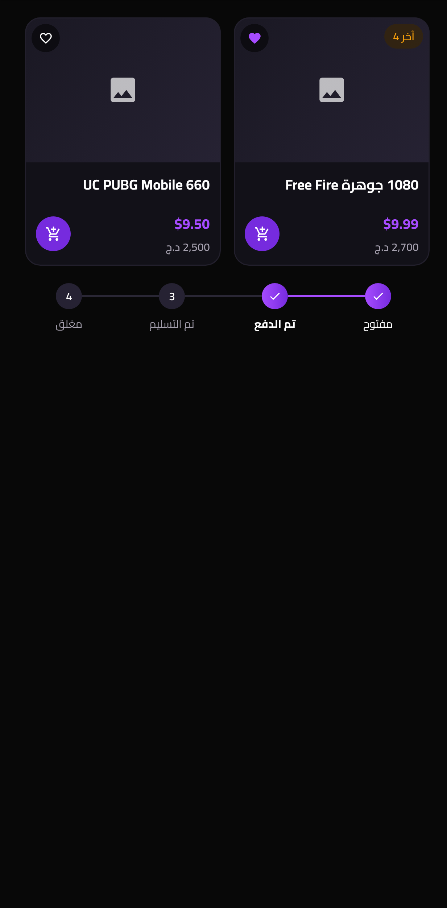

# MED-K — سوق الخدمات الرقمية (تطبيق أندرويد أصلي)

تطبيق أندرويد أصلي مكتوب بـ **Kotlin + Jetpack Compose (Material 3)** بنمط **MVVM**، الخادم على **Firebase (الخطة المجانية)**: Authentication و Firestore مع قواعد أمان صارمة و App Check. لا يحتوي على أي WebView أو HTML.

| الرئيسية | الترحيب | تسجيل الدخول | المنتجات |
|---|---|---|---|
|  |  |  |  |

## 📱 تطبيقان من نفس المشروع
| التطبيق | المعرّف | لمن |
|---|---|---|
| **MED-K** | `com.medk.app` | العملاء + مساحة عمل البائعين |
| **MED-K Admin** | `com.medk.admin` | **المالك فقط** — لوحة التحكم الكاملة |

**MED-K Admin** يحتوي على: لوحة الإحصائيات، الطلبات (إسناد وتغيير الحالة)، المحادثات، المنتجات، **البائعون والصلاحيات** (إنشاء بائع، إيقاف/تفعيل، تغيير كلمة المرور، تحويله إلى عميل، والأقسام المسموحة)، **العملاء** (بحث، طلباتهم، إيقاف/تفعيل، ترقية إلى بائع)، الأقسام، البانرات وأسعار P2P. أي حساب غير المالك يُرفض في هذا التطبيق.

صلاحيات كل بائع (تُفرض في قاعدة البيانات عبر RLS، وليس في الواجهة فقط):
- إدارة المنتجات (في الأقسام المسموحة فقط)
- تحديث حالة الطلبات المسندة إليه
- إدارة أسعار P2P
- عرض الإحصائيات والإيرادات الخاصة بطلباته

> في Firebase أضف تطبيق Android ثانياً بالمعرّف `com.medk.admin` (مع بصمات SHA) ثم نزّل `google-services.json` من جديد — الملف الواحد يحتوي التطبيقين.

```bash
./gradlew assembleStoreProdDebug   # MED-K
./gradlew assembleAdminProdDebug   # MED-K Admin
./gradlew bundleStoreProdRelease bundleAdminProdRelease   # AAB لمتجر Google Play
```

## 🧪 النسخة التجريبية (Demo) — بدون خادم
للتجربة السريعة يوجد إصدار **demo** يعمل بالكامل بدون أي خادم، ببيانات تجريبية في الذاكرة (تُعاد عند إعادة تشغيل التطبيق):
- MED-K Demo: الدخول بضغطة واحدة كـ **عميل** أو **بائع**. MED-K Admin Demo: زر **دخول كمالك**.
- كل الشاشات تعمل: الأقسام، المنتجات، السلة (مع تقسيم الطلب حسب البائع)، المحادثات مع **رد تلقائي من البائع**، تتبع الطلبات، لوحة المالك، إدارة المنتجات والموظفين.
- يُثبَّت بجانب النسخة الحقيقية (`com.medk.app.demo`) باسم **MED-K Demo**.
```bash
./gradlew assembleStoreDemoDebug assembleAdminDemoDebug
```
أو من GitHub Actions: Artifact باسم **`MED-K-DEMO-apks`** (يحتوي التطبيقين).

## المحتويات
- [البنية](#البنية)
- [الأمان](#الأمان)
- [1. إعداد مشروع Firebase](#1-إعداد-مشروع-firebase)
- [2. نشر الخادم (Rules + Functions)](#2-نشر-الخادم-rules--functions)
- [3. تشغيل التطبيق محلياً](#3-تشغيل-التطبيق-محلياً)
- [4. توليد APK و AAB](#4-توليد-apk-و-aab)
- [5. GitHub Actions والأسرار](#5-github-actions-والأسرار)
- [6. اختبارات الأمان](#6-اختبارات-الأمان)
- [الأدوار والصلاحيات](#الأدوار-والصلاحيات)

## البنية
```
app/src/main/java/com/medk/app/
├── core/        AppContainer، الاتصال، التحديثات، رسائل الأخطاء
├── data/        النماذج والمستودعات (Firestore) + data/demo للنسخة التجريبية
└── ui/          الشاشات (Compose) — المتجر، لوحة المالك، المصادقة…
firebase/
├── firestore.rules.tmpl   قواعد الأمان (قالب: يُحقن بريد المالك عند النشر)
├── firestore.indexes.json الفهارس
├── deploy.sh              نشر بأمر واحد من Cloud Shell
└── tests/                 اختبارات الأمان على المحاكي
```

## الخادم على الخطة المجانية (Spark)
الخطة المجانية لا تتضمن Cloud Functions ولا Cloud Storage، لذلك:
- **قواعد Firestore هي الخادم:** كل قاعدة عمل (الأسعار، الإجماليات، البائع المسؤول، المخزون، الأدوار، الصلاحيات، عزل البيانات) تُفحص في القواعد على خوادم Google — تطبيق معدّل لا يستطيع التحايل عليها.
- **طلب لكل منتج:** كل منتج في السلة يصبح طلباً مستقلاً مع محادثة مع البائع المسؤول عنه.
- **الصور:** تُضغط داخل التطبيق وتُحفظ في Firestore (≈ 650 كيلوبايت كحد أقصى). **ملفات PDF** حتى 650 كيلوبايت. **الفيديو غير متاح** في المحادثات.
- **الإشعارات:** يستنتجها التطبيق مباشرة من الطلبات والمحادثات (بدون خادم).
- **كلمة مرور البائع:** المالك يرسل له رابط تغيير كلمة المرور على بريده.
- **إيقاف حساب:** يُمنع فوراً من قراءة أو كتابة أي بيانات.
- **إتمام الطلب** يتطلب بريداً مؤكداً (حماية من الحسابات الوهمية).

| المسار | المحتوى | من يكتب |
|---|---|---|
| `users/{uid}` | الدور، التفعيل، الصلاحيات، الأقسام | المستخدم (اسمه فقط) / المالك |
| `publicProfiles/{uid}` | الاسم + الصورة + الدور | صاحبها أو المالك (الدور مطابق للحقيقي) |
| `categories`, `sections`, `banners` | الكتالوج | المالك |
| `products` | المنتجات | المالك / البائع بصلاحية وفي قسمه |
| `media` | صور الكتالوج المضغوطة | المالك / البائع بصلاحية |
| `p2pAssets` | أسعار العملات | المالك / البائع بصلاحية P2P |
| `orders` | الطلبات | العميل ينشئ (بأسعار مطابقة)، البائع/المالك يغيّر الحالة |
| `conversations/{id}/messages`, `/files` | المحادثات والمرفقات | أطراف المحادثة فقط |

## 1. إعداد مشروع Firebase (مجاني)
1. أنشئ مشروعاً في [Firebase Console](https://console.firebase.google.com) — **الخطة المجانية Spark تكفي**.
2. أضف تطبيقي Android: `com.medk.app` و `com.medk.admin` مع بصمات SHA-1/SHA-256.
3. **Authentication → Sign-in method:** فعّل Email/Password و Google.
4. **Firestore Database:** أنشئ القاعدة (أو يتولى ذلك `deploy.sh`).
5. (اختياري ومجاني) **App Check** مع Play Integrity، ثم Enforce على Firestore.
6. نزّل `google-services.json` وضعه في `app/` أو في GitHub Secret `GOOGLE_SERVICES_JSON`.

## 2. نشر الخادم (قواعد الحماية)
من Google Cloud Shell بسطر واحد:
```bash
rm -rf medk-app && git clone -b ccr-d079e25d-odpocv https://github.com/ya3in3335/M medk-app && bash medk-app/firebase/deploy.sh
```
يأخذ المشروع وبريدك (كمالك) من حساب Cloud Shell. لبريد مالك مختلف: `OWNER_EMAILS=you@mail.com bash medk-app/firebase/deploy.sh`.
عند أول دخول للمالك (ببريد مؤكد) تُنشأ الأقسام الخمسة والأقسام الفرعية تلقائياً (بدون منتجات وهمية).

## 3. تشغيل التطبيق محلياً
```bash
./gradlew installStoreProdDebug     # MED-K
./gradlew installAdminProdDebug     # MED-K Admin
```

## 4. توليد APK و AAB
```bash
./gradlew assembleStoreProdDebug assembleAdminProdDebug
./gradlew bundleStoreProdRelease bundleAdminProdRelease
```

## 5. GitHub Actions
- **backend:** اختبارات قواعد الأمان على المحاكي.
- **build:** التطبيقات الأربعة + AAB + نشر Release (مصدر التحديثات داخل التطبيق).
- **deploy-backend:** نشر القواعد يدوياً (يحتاج `FIREBASE_SERVICE_ACCOUNT`, `FIREBASE_PROJECT_ID`, `OWNER_EMAILS`).

## 6. اختبارات الأمان
```bash
cd firebase/tests && npm ci && npm run emulate
```
37 مجموعة اختبارات تحاول: تزوير الدور، منح صلاحيات للنفس، قراءة بيانات الآخرين، تعديل الأسعار والإجماليات، اختيار بائع آخر، طلب منتج مخفي، تجاوز المخزون، انتحال مرسل رسالة، مرفقات خارج المحادثة — وكلها مرفوضة.

## الأدوار والصلاحيات
| الدور | ما يمكنه فعله |
|---|---|
| **العميل** | التصفح، السلة، طلباته ومحادثاته فقط |
| **البائع** | المحادثات والطلبات المسندة إليه فقط، وما منحه المالك من: المنتجات، تحديث الطلبات، أسعار P2P، الإحصائيات |
| **المالك** | عبر تطبيق MED-K Admin: كل ما سبق + البائعون وصلاحياتهم، العملاء، الأقسام، الإسناد، البانرات وأسعار P2P |

## لقطات الشاشة (اختبارات)
```bash
./gradlew recordRoborazziStoreProdDebug recordRoborazziStoreDemoDebug recordRoborazziAdminDemoDebug
```
