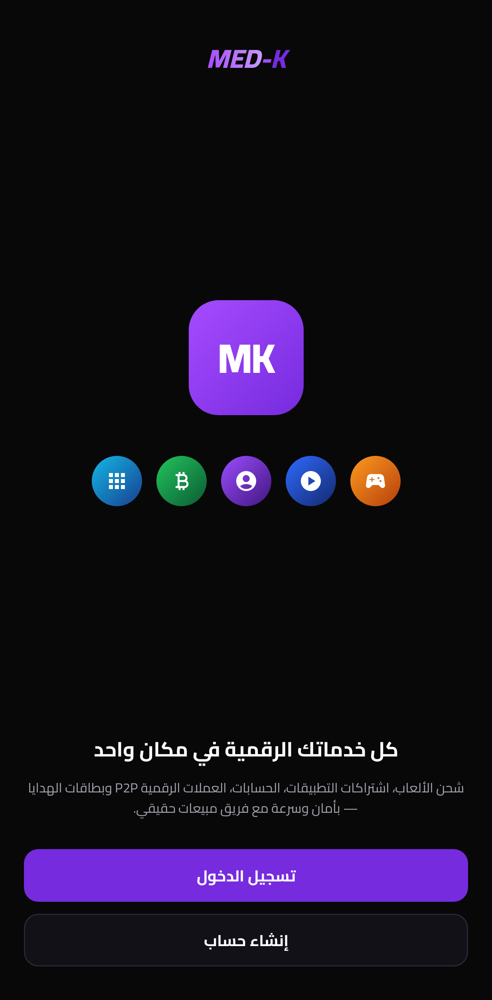
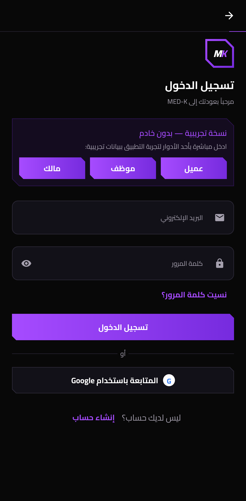

# MED-K — سوق الخدمات الرقمية (تطبيق أندرويد أصلي)

تطبيق أندرويد أصلي مكتوب بـ **Kotlin + Jetpack Compose (Material 3)** بنمط **MVVM**، الخادم بالكامل على **Firebase**: Authentication، Firestore، Cloud Storage، Cloud Functions و App Check. لا يحتوي على أي WebView أو HTML.

| الرئيسية | الترحيب | تسجيل الدخول | المنتجات |
|---|---|---|---|
|  |  |  |  |

## 📱 تطبيقان من نفس المشروع
| التطبيق | المعرّف | لمن |
|---|---|---|
| **MED-K** | `com.medk.app` | العملاء + مساحة عمل البائعين |
| **MED-K Admin** | `com.medk.admin` | **المالك فقط** — لوحة التحكم الكاملة |

**MED-K Admin** يحتوي على: لوحة الإحصائيات، الطلبات (إسناد وتغيير الحالة)، المحادثات، المنتجات، **البائعون والصلاحيات** (إنشاء بائع، إيقاف/تفعيل، تغيير كلمة المرور، تحويله إلى عميل، والأقسام المسموحة)، **العملاء** (بحث، طلباتهم، إيقاف/تفعيل، ترقية إلى بائع)، الأقسام، البانرات وأسعار P2P. أي حساب غير المالك يُرفض في هذا التطبيق.

صلاحيات كل بائع (تُفرض في قاعدة البيانات عبر RLS، وليس في الواجهة فقط):
- إدارة المنتجات (في الأقسام المسموحة فقط)
- تحديث حالة الطلبات المسندة إليه
- إدارة أسعار P2P
- عرض الإحصائيات والإيرادات الخاصة بطلباته

> في Firebase أضف تطبيق Android ثانياً بالمعرّف `com.medk.admin` (مع بصمات SHA) ثم نزّل `google-services.json` من جديد — الملف الواحد يحتوي التطبيقين.

```bash
./gradlew assembleStoreProdDebug   # MED-K
./gradlew assembleAdminProdDebug   # MED-K Admin
./gradlew bundleStoreProdRelease bundleAdminProdRelease   # AAB لمتجر Google Play
```

## 🧪 النسخة التجريبية (Demo) — بدون خادم
للتجربة السريعة يوجد إصدار **demo** يعمل بالكامل بدون أي خادم، ببيانات تجريبية في الذاكرة (تُعاد عند إعادة تشغيل التطبيق):
- MED-K Demo: الدخول بضغطة واحدة كـ **عميل** أو **بائع**. MED-K Admin Demo: زر **دخول كمالك**.
- كل الشاشات تعمل: الأقسام، المنتجات، السلة (مع تقسيم الطلب حسب البائع)، المحادثات مع **رد تلقائي من البائع**، تتبع الطلبات، لوحة المالك، إدارة المنتجات والموظفين.
- يُثبَّت بجانب النسخة الحقيقية (`com.medk.app.demo`) باسم **MED-K Demo**.
```bash
./gradlew assembleStoreDemoDebug assembleAdminDemoDebug
```
أو من GitHub Actions: Artifact باسم **`MED-K-DEMO-apks`** (يحتوي التطبيقين).

## المحتويات
- [البنية](#البنية)
- [الأمان](#الأمان)
- [1. إعداد مشروع Firebase](#1-إعداد-مشروع-firebase)
- [2. نشر الخادم (Rules + Functions)](#2-نشر-الخادم-rules--functions)
- [3. تشغيل التطبيق محلياً](#3-تشغيل-التطبيق-محلياً)
- [4. توليد APK و AAB](#4-توليد-apk-و-aab)
- [5. GitHub Actions والأسرار](#5-github-actions-والأسرار)
- [6. اختبارات الأمان](#6-اختبارات-الأمان)
- [الأدوار والصلاحيات](#الأدوار-والصلاحيات)

## البنية
```
app/src/main/java/com/medk/app/
├── core/        AppContainer، رسائل الأخطاء، التنسيق
├── data/        النماذج والمستودعات (Firestore / Storage / Functions) + data/demo للنسخة التجريبية
└── ui/          الشاشات (Compose) — المتجر، لوحة المالك، المصادقة…
firebase/
├── firestore.rules        قواعد أمان Firestore (رفض افتراضي)
├── storage.rules          قواعد أمان التخزين
├── firestore.indexes.json الفهارس
├── functions/             Cloud Functions (TypeScript) — كل العمليات الحساسة
└── tests/                 اختبارات الأمان على المحاكي (64 اختباراً)
```

**هيكل البيانات في Firestore**

| المسار | المحتوى | من يكتب |
|---|---|---|
| `users/{uid}` | الملف الخاص: الدور، التفعيل، الصلاحيات، الأقسام | Cloud Functions فقط (المستخدم يعدّل اسمه فقط) |
| `publicProfiles/{uid}` | الاسم + الصورة + الدور | Cloud Functions |
| `categories`, `sections`, `banners` | الكتالوج | المالك |
| `products` | المنتجات | المالك / البائع بصلاحية وفي قسمه |
| `p2pAssets` | أسعار العملات | المالك / البائع بصلاحية P2P |
| `orders` | الطلبات (العناصر داخل الطلب) | **Cloud Functions فقط** |
| `conversations/{id}/messages` | المحادثات والرسائل | المحادثة: Functions — الرسالة: الطرفان فقط |
| `users/{uid}/notifications`, `users/{uid}/favorites` | الإشعارات والمفضلة | Functions / المستخدم نفسه |

**Cloud Functions:** `bootstrap`, `checkout`, `startConversation`, `setOrderStatus`, `assignOrder`, `dashboardStats`, `adminCreateStaff`, `adminSetPassword`, `adminSetActive`, `adminSetRole`, `adminSetPermissions`, ومشغّلات `onMessageCreated` و `syncPublicProfile`.

## الأمان
- **الأدوار في Custom Claims** تضعها Cloud Functions فقط، وتُطابَق مع ملف المستخدم في كل طلب — دور مزوّر لا يعطي أي صلاحية.
- **رفض افتراضي** في Firestore و Storage: كل مسار غير مذكور مرفوض.
- **الطلبات والأسعار على الخادم:** `checkout` يقرأ الأسعار والمخزون من قاعدة البيانات داخل Transaction، يقسم الطلب حسب البائع، ويمنع المخزون السالب. العميل لا يستطيع إنشاء أو تعديل أي طلب.
- **عزل البيانات:** العميل يرى طلباته ومحادثاته فقط، البائع يرى المسند إليه فقط، والحساب الموقوف يفقد كل وصول فوراً (Firebase Auth معطّل + إلغاء الجلسات + رفض في القواعد).
- **التحقق من البيانات** في القواعد: الحقول المسموحة فقط، الأطوال، الأسعار ≥ 0، توقيت الخادم للرسائل، مرفقات داخل مجلد المحادثة نفسها فقط.
- **App Check (Play Integrity):** دوال الخادم ترفض أي طلب لا يأتي من التطبيق الرسمي. فعّل الإنفاذ أيضاً على Firestore و Storage من لوحة Firebase.
- **تحديد المعدل (Rate limiting)** على `checkout` و `startConversation` وإنشاء البائعين.
- **المالك** يُرقّى تلقائياً فقط إذا كان بريده في `OWNER_EMAILS` **ومؤكَّداً** — لا يمكن لأحد حجز بريد المالك مسبقاً.
- **الملفات:** صور الكتالوج (≤ 10MB، صور فقط) ومرفقات المحادثات خاصة (≤ 50MB، صورة/فيديو/PDF فقط) ولا يقرؤها إلا أطراف المحادثة.
- لا يوجد أي مفتاح سري داخل التطبيق.

## 1. إعداد مشروع Firebase
1. أنشئ مشروعاً في [Firebase Console](https://console.firebase.google.com) وفعّل خطة **Blaze** (مطلوبة لـ Cloud Functions).
2. أضف تطبيقي Android: `com.medk.app` و `com.medk.admin`، وأضف بصمات **SHA-1 و SHA-256** (debug و release ومفتاح Play App Signing).
3. **Authentication → Sign-in method:** فعّل Email/Password و Google.
4. **Firestore Database:** أنشئ قاعدة البيانات (Production mode، منطقة `europe-west1` مثلاً).
5. **Storage:** فعّل التخزين.
6. **App Check:** سجّل التطبيقين مع **Play Integrity**. لنسخ debug سجّل «Debug token» الذي يظهر في Logcat. بعد التأكد فعّل **Enforce** على Firestore و Storage.
7. نزّل `google-services.json` (يحتوي التطبيقين) وضعه في `app/google-services.json`.

## 2. نشر الخادم (Rules + Functions)
```bash
npm install -g firebase-tools
cd firebase
cp .firebaserc.example .firebaserc        # ضع معرّف مشروعك
printf 'OWNER_EMAILS=owner@example.com\nENFORCE_APP_CHECK=true\n' > functions/.env.<project-id>
npm ci --prefix functions
firebase deploy --only firestore,storage,functions
```
- `OWNER_EMAILS`: بريد المالك (يجب تأكيده). عند أول دخول له يصبح مالكاً وتُنشأ الأقسام الخمسة والأقسام الفرعية تلقائياً (بدون منتجات وهمية).
- منطقة الدوال `europe-west1` (غيّرها في `functions/src/core.ts` و `FUNCTIONS_REGION` في التطبيق معاً).

## 3. تشغيل التطبيق محلياً
المتطلبات: Android Studio، JDK 17، Android SDK 35.
```bash
# ضع app/google-services.json
./gradlew installStoreProdDebug     # MED-K
./gradlew installAdminProdDebug     # MED-K Admin
```
اختياري: `secrets.properties` (انظر `secrets.properties.example`) لـ `GOOGLE_WEB_CLIENT_ID` و `FUNCTIONS_REGION`.
بدون `google-services.json` يعرض التطبيق شاشة «التطبيق غير مُهيأ».

## 4. توليد APK و AAB
```bash
./gradlew assembleStoreProdDebug assembleAdminProdDebug           # APK للتجربة
./gradlew bundleStoreProdRelease bundleAdminProdRelease           # AAB لمتجر Google Play
```
للتوقيع أنشئ مفتاحاً مرة واحدة:
```bash
keytool -genkeypair -v -keystore medk-release.jks -alias medk -keyalg RSA -keysize 2048 -validity 10000
```
ثم أضف إلى `secrets.properties`: `MEDK_KEYSTORE_PATH`, `MEDK_KEYSTORE_PASSWORD`, `MEDK_KEY_ALIAS`, `MEDK_KEY_PASSWORD`.

## 5. GitHub Actions والأسرار
`.github/workflows/android.yml`:
- **backend:** بناء Cloud Functions وتشغيل اختبارات الأمان على محاكي Firebase.
- **build:** ترجمة، اختبارات، APK للتطبيقين (حقيقي + تجريبي) و AAB.
- **deploy-backend:** نشر القواعد والفهارس والدوال — يدوياً من Actions → Run workflow.

| السر | الوصف |
|---|---|
| `GOOGLE_SERVICES_JSON` | `base64 -w0 app/google-services.json` |
| `FIREBASE_SERVICE_ACCOUNT` | JSON حساب خدمة بصلاحية النشر (للنشر فقط) |
| `FIREBASE_PROJECT_ID` | معرّف مشروع Firebase |
| `OWNER_EMAILS` | بريد المالك |
| `GOOGLE_WEB_CLIENT_ID` | (اختياري) |
| `MEDK_KEYSTORE_BASE64`, `MEDK_KEYSTORE_PASSWORD`, `MEDK_KEY_ALIAS`, `MEDK_KEY_PASSWORD` | (اختياري) توقيع الإصدار |

## 6. اختبارات الأمان
```bash
cd firebase/functions && npm ci && npm run build
cd ../tests && npm ci
printf 'ENFORCE_APP_CHECK=false\nOWNER_EMAILS=owner@test.dev\n' > ../functions/.env.local
npx firebase emulators:exec --project demo-medk --config ../firebase.json --only auth,firestore,storage,functions "npm test"
```
64 اختباراً تحاول: رفع الصلاحيات، تزوير الدور، قراءة طلبات الآخرين، تعديل الأسعار، إنشاء طلب مزيف، انتحال مرسل رسالة، رفع ملفات تنفيذية، تجاوز المخزون، والإغراق بالطلبات — وكلها يجب أن تُرفض.

## الأدوار والصلاحيات
| الدور | ما يمكنه فعله |
|---|---|
| **العميل** | التصفح، السلة، طلباته ومحادثاته فقط |
| **البائع** | المحادثات والطلبات المسندة إليه فقط، وما منحه المالك من: المنتجات، تحديث الطلبات، أسعار P2P، الإحصائيات |
| **المالك** | عبر تطبيق MED-K Admin: كل ما سبق + البائعون وصلاحياتهم، العملاء، الأقسام، الإسناد، البانرات وأسعار P2P |

## لقطات الشاشة (اختبارات)
```bash
./gradlew recordRoborazziStoreProdDebug recordRoborazziStoreDemoDebug recordRoborazziAdminDemoDebug
```
