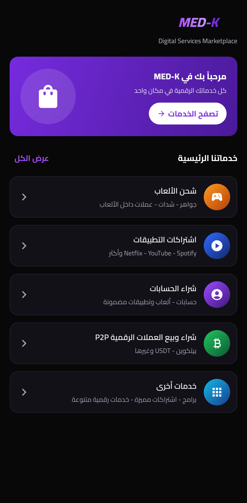

# MED-K — سوق الخدمات الرقمية (تطبيق أندرويد أصلي)

تطبيق أندرويد أصلي مكتوب بـ **Kotlin + Jetpack Compose (Material 3)** بنمط **MVVM**، يعتمد على **Firebase Authentication** لتسجيل الدخول و **Supabase** للبيانات والمحادثات الفورية والتخزين. لا يحتوي على أي WebView أو HTML.

| الرئيسية | الترحيب | تسجيل الدخول | المنتجات |
|---|---|---|---|
|  |  |  |  |

## 🧪 النسخة التجريبية (Demo) — بدون خادم
للتجربة السريعة يوجد إصدار **demo** يعمل بالكامل بدون Firebase أو Supabase، ببيانات تجريبية في الذاكرة (تُعاد عند إعادة تشغيل التطبيق):
- الدخول بضغطة واحدة كـ **عميل / موظف / مالك** من شاشة الترحيب.
- كل الشاشات تعمل: الأقسام، المنتجات، السلة (مع تقسيم الطلب حسب البائع)، المحادثات مع **رد تلقائي من البائع**، تتبع الطلبات، لوحة المالك، إدارة المنتجات والموظفين.
- يُثبَّت بجانب النسخة الحقيقية (`com.medk.app.demo`) باسم **MED-K Demo**.
```bash
./gradlew assembleDemoDebug   # app/build/outputs/apk/demo/debug/app-demo-debug.apk
```
أو من GitHub Actions: Artifact باسم **`MED-K-DEMO-apk`**.

## المحتويات
- [الميزات](#الميزات)
- [البنية](#البنية)
- [1. إعداد Firebase](#1-إعداد-firebase)
- [2. إعداد الخادم (Supabase)](#2-إعداد-الخادم-supabase)
- [3. تشغيل التطبيق محلياً](#3-تشغيل-التطبيق-محلياً)
- [4. توليد APK](#4-توليد-apk)
- [5. توليد AAB لمتجر Google Play](#5-توليد-aab-لمتجر-google-play)
- [6. GitHub Actions والأسرار](#6-github-actions-والأسرار)
- [الأدوار والصلاحيات](#الأدوار-والصلاحيات)

## الميزات
- **المصادقة (Firebase حقيقي):** شاشة البداية، الترحيب، تسجيل الدخول، إنشاء حساب، استعادة كلمة المرور، الدخول عبر Google (Credential Manager).
- **العميل:** الرئيسية (بانرات قابلة للسحب + الأقسام الخمسة بألوانها)، جميع الأقسام، شاشة مخصصة لكل قسم (الألعاب، الاشتراكات، الحسابات، P2P مع حاسبة أسعار، الخدمات الأخرى)، صفحة المنتج (معرض صور، USD/DZD، التوفر، الكمية)، البحث، المفضلة، السلة، الطلبات وتتبعها بمؤشر تقدم، المحادثات الفورية (نص، صور، فيديو، PDF)، الإشعارات، الحساب والإعدادات (داكن/فاتح، العربية، الإشعارات)، القائمة الجانبية.
- **السلة متعددة البائعين:** عند إتمام الطلب تُنشئ دالة على الخادم **طلباً منفصلاً ومحادثة منفصلة لكل مندوب مبيعات** مسؤول عن القسم/اللعبة، وتُحسب الأسعار من قاعدة البيانات (لا يُوثق بسعر العميل).
- **لوحة المالك:** الإحصائيات، الطلبات (تصفية، إسناد، تغيير الحالة)، المنتجات، الأقسام الرئيسية، الأقسام الفرعية (الألعاب/التطبيقات وتعيين البائع)، الموظفون (إنشاء، صلاحيات، أقسام مسموحة، تفعيل/إيقاف، تغيير كلمة المرور)، البانرات، أسعار P2P.
- **مساحة الموظف:** المحادثات والطلبات المسندة إليه فقط، تحديث حالة الدفع/التسليم، إدارة المنتجات ضمن الأقسام المسموحة فقط.

## البنية
```
app/src/main/java/com/medk/app/
├── core/          AppContainer (حقن التبعيات)، أدوات التنسيق ورسائل الأخطاء
├── data/          النماذج والمستودعات: Auth, Catalog, Cart, Orders, Chat, Admin, Notifications, Settings, EdgeFunctions
└── ui/
    ├── theme/         الألوان، خط Cairo، الوضع الداكن/الفاتح، RTL
    ├── components/    مكونات Compose قابلة لإعادة الاستخدام + ViewModels عامة
    ├── navigation/    المسارات
    ├── auth/ home/ catalog/ product/ cart/ chat/ orders/ profile/ admin/
supabase/
├── migrations/    مخطط قاعدة البيانات + RLS + الدوال (إضافي وآمن للتكرار)
└── functions/     auth-bootstrap و admin-staff (تتحقق من رمز Firebase على الخادم)
```

**الأمان:**
- التطبيق يحمل فقط `SUPABASE_ANON_KEY` (مفتاح عام بطبيعته). **مفتاح service_role لا يوجد إلا في Edge Functions على الخادم.**
- Supabase يتحقق من رمز Firebase عبر ميزة **Third-party Auth**، وكل سياسات RLS تستخدم `auth.jwt()->>'sub'` (معرّف Firebase).
- العمليات الحساسة (إنشاء موظف، تغيير كلمة مروره، إيقافه) تتم عبر Edge Function `admin-staff` التي تتحقق من الرمز ومن أن المستدعي هو المالك.
- ملفات المحادثات في حاوية خاصة `chat-attachments` ولا تُعرض إلا بروابط موقعة مؤقتة لأطراف المحادثة.

## 1. إعداد Firebase
1. أنشئ مشروعاً في [Firebase Console](https://console.firebase.google.com) وأضف تطبيق Android باسم الحزمة `com.medk.app`.
2. أضف بصمات **SHA-1 و SHA-256** لمفتاح التوقيع (debug و release) — ضرورية لتسجيل الدخول عبر Google:
   ```bash
   keytool -list -v -keystore ~/.android/debug.keystore -alias androiddebugkey -storepass android -keypass android
   ```
   > ملاحظة: بناء GitHub Actions يستخدم مفتاح debug مختلفاً في كل تشغيل، لذا أضف بصمة مفتاح الإصدار (release) للنسخ الموزعة.
3. من **Authentication → Sign-in method** فعّل **Email/Password** و **Google**.
4. نزّل `google-services.json` وضعه في `app/google-services.json` (الملف مُستثنى من git).
5. من **Project settings → Service accounts** أنشئ مفتاحاً خاصاً (JSON) — سيُستخدم **فقط** كسر في Supabase Edge Functions.

## 2. إعداد الخادم (Supabase)
> ⚠️ **قاعدة البيانات الحالية:** ملف الترحيل `supabase/migrations/20261122000000_medk_marketplace.sql` مكتوب بشكل **إضافي** (`CREATE ... IF NOT EXISTS` و `ADD COLUMN IF NOT EXISTS`) ولا يحذف أو يعيد إنشاء أي جدول. مع ذلك **راجعه مقابل جداولك الحالية قبل تطبيقه على الإنتاج** — إذا كانت أسماء الجداول أو الأعمدة لديك مختلفة فعدّل الاستعلامات في `data/*Repository.kt` أو أنشئ Views بنفس الأسماء. خذ نسخة احتياطية أولاً.

1. **ربط Firebase بـ Supabase:** Dashboard → Authentication → **Sign In / Providers → Third-party Auth → Firebase** وأدخل Firebase Project ID.
2. **تطبيق المخطط:** عبر SQL Editor أو:
   ```bash
   supabase link --project-ref <ref>
   supabase db push
   ```
   ينشئ: الجداول، سياسات RLS، الدوال (`create_orders_from_cart`, `start_conversation`, `dashboard_stats`)، حاويات التخزين، النشر الفوري (Realtime)، والأقسام الخمسة مع الأقسام الفرعية (Free Fire, PUBG Mobile, Netflix…). **لا تُضاف أي منتجات وهمية** — المنتجات يضيفها المالك من التطبيق.
3. **نشر Edge Functions مع الأسرار:**
   ```bash
   supabase secrets set FIREBASE_SERVICE_ACCOUNT="$(cat firebase-service-account.json)"
   supabase secrets set OWNER_EMAILS="owner@example.com"
   supabase functions deploy auth-bootstrap --no-verify-jwt
   supabase functions deploy admin-staff --no-verify-jwt
   ```
   - `--no-verify-jwt` لأن الدالتين تتحققان بنفسيهما من رمز Firebase بواسطة Firebase Admin SDK.
   - `OWNER_EMAILS`: البريد (أو عدة عناوين مفصولة بفواصل) الذي يحصل على دور **المالك** عند أول تسجيل دخول.
4. عند كل تسجيل دخول يستدعي التطبيق `auth-bootstrap` التي: تتحقق من الرمز، تضيف المطالبة `role: authenticated` المطلوبة من Supabase، وتنشئ ملف المستخدم إن لم يوجد (دون تغيير دور موجود).

## 3. تشغيل التطبيق محلياً
المتطلبات: Android Studio (Ladybug أو أحدث)، JDK 17، Android SDK 35.
```bash
cp secrets.properties.example secrets.properties   # ثم املأ القيم
# ضع app/google-services.json
./gradlew installDebug
```
محتوى `secrets.properties` (غير مرفوع إلى git):
```
SUPABASE_URL=https://xxxx.supabase.co
SUPABASE_ANON_KEY=...
GOOGLE_WEB_CLIENT_ID=xxxx.apps.googleusercontent.com   # اختياري إذا كان google-services.json يحتوي عميل الويب
```
إذا كانت الإعدادات ناقصة يعرض التطبيق شاشة "التطبيق غير مُهيأ" بدلاً من التعطل.

## 4. توليد APK
```bash
./gradlew assembleProdDebug
# app/build/outputs/apk/prod/debug/app-prod-debug.apk
```
أو من GitHub: **Actions → Android build → آخر تشغيل → Artifacts → `MED-K-debug-apk`**.

## 5. توليد AAB لمتجر Google Play
1. أنشئ مفتاح توقيع (مرة واحدة واحتفظ به بأمان):
   ```bash
   keytool -genkeypair -v -keystore medk-release.jks -alias medk -keyalg RSA -keysize 2048 -validity 10000
   ```
2. محلياً أضف إلى `secrets.properties`:
   ```
   MEDK_KEYSTORE_PATH=/path/to/medk-release.jks
   MEDK_KEYSTORE_PASSWORD=...
   MEDK_KEY_ALIAS=medk
   MEDK_KEY_PASSWORD=...
   ```
3. ```bash
   ./gradlew bundleProdRelease
   # app/build/outputs/bundle/prodRelease/app-prod-release.aab
   ```
4. ارفع الـ AAB إلى Google Play Console (مع تفعيل Play App Signing). أضف بصمة SHA-1 لمفتاح Play App Signing إلى Firebase.

## 6. GitHub Actions والأسرار
الملف `.github/workflows/android.yml` يقوم بـ: ترجمة Kotlin، تشغيل اختبارات الوحدات ولقطات الشاشة، بناء Debug APK، بناء Release AAB و APK، ورفعها كـ Artifacts.

أضف من **Settings → Secrets and variables → Actions**:

| السر | الوصف |
|---|---|
| `GOOGLE_SERVICES_JSON` | محتوى `google-services.json` بترميز base64: `base64 -w0 app/google-services.json` |
| `SUPABASE_URL` | رابط مشروع Supabase |
| `SUPABASE_ANON_KEY` | المفتاح العام anon (ليس service_role) |
| `GOOGLE_WEB_CLIENT_ID` | (اختياري) Web client ID لتسجيل Google |
| `MEDK_KEYSTORE_BASE64` | (اختياري) مفتاح التوقيع base64 |
| `MEDK_KEYSTORE_PASSWORD` / `MEDK_KEY_ALIAS` / `MEDK_KEY_PASSWORD` | (اختياري) بيانات مفتاح التوقيع |

بدون أسرار التوقيع يُبنى AAB غير موقّع؛ بدون `GOOGLE_SERVICES_JSON` يُبنى التطبيق لكنه يعرض شاشة الإعداد.

## الأدوار والصلاحيات
| الدور | ما يمكنه فعله |
|---|---|
| **العميل** | التصفح، السلة، طلباته ومحادثاته فقط |
| **الموظف** | المحادثات والطلبات المسندة إليه فقط؛ تحديث الحالة إذا مُنح `can_update_orders`؛ إدارة المنتجات في الأقسام المسموحة إذا مُنح `can_manage_products` |
| **المالك** | كل ما سبق + إدارة الأقسام، الموظفين، الصلاحيات، الإسناد، البانرات وأسعار P2P |

تُفرض هذه القواعد في قاعدة البيانات عبر RLS والمشغّلات (triggers)، وليس في الواجهة فقط.

## لقطات الشاشة (اختبارات)
```bash
./gradlew recordRoborazziProdDebug recordRoborazziDemoDebug   # يحدّث الصور في app/screenshots
```
